<h1>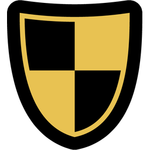 Heraldry</h1>

A World of Warcraft **Forever** add-on that shows an icon next to the names of the guilds and players you
choose, on friendly and enemy nameplates. Mark your own guild, your allies, your rivals, or one particular
player.

  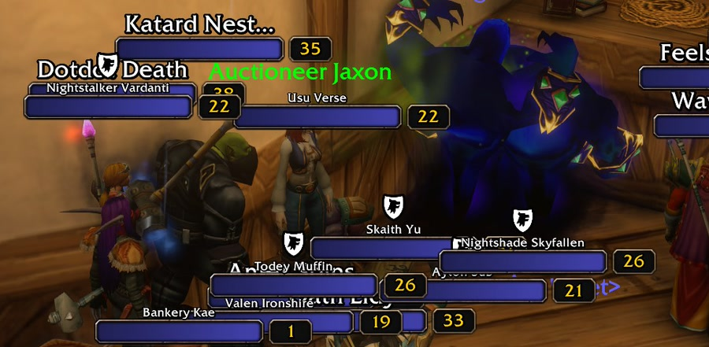
  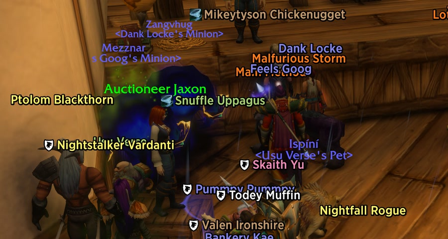

## Features
- An icon for any guild, an icon (or no icon) for any player, and a "my guild" icon that follows whichever
  guild your character is in.
- Icons from Heraldry's own library (over 400 black-and-white heraldic icons in 14 categories), the game's
  built-in icons (named and searchable by every class ability, talent and rune that uses them), the
  TwitchEmotes add-on if you have it, or your own image files.
- Works on its own with **Blizzard's nameplates**: no other add-on needed. For a nicer look we recommend
  **EllesmereUI Nameplates**, which Heraldry fully supports (full plates, name-only and enemy plates, skinned
  to match EllesmereUI, with its own section in EUI's options). Plater, ElvUI and Threat Plates have
  adapters too (untested in game so far). With any other nameplate add-on (Platynator,
  small Forever plate add-ons) the icon sits centred above the nameplate; plates a known add-on hides never
  get an icon.
- Position, size, gap, offsets and opacity, with a live preview; per-context visibility (world, dungeons,
  raids, PvP, combat). On Blizzard's own nameplates the icon can span the name and health bar, like a crest.
- Settings shared by all characters, or per character.
- Share your setup as a text string; others preview it before applying.

## Screenshots

<table>
  <tr>
    <td width="50%">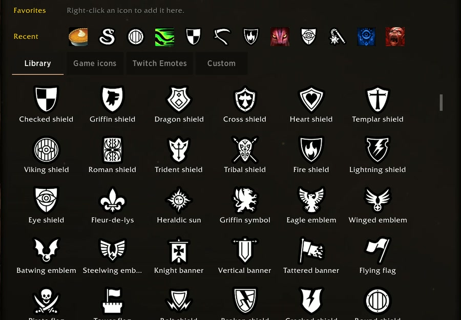</td>
    <td width="50%">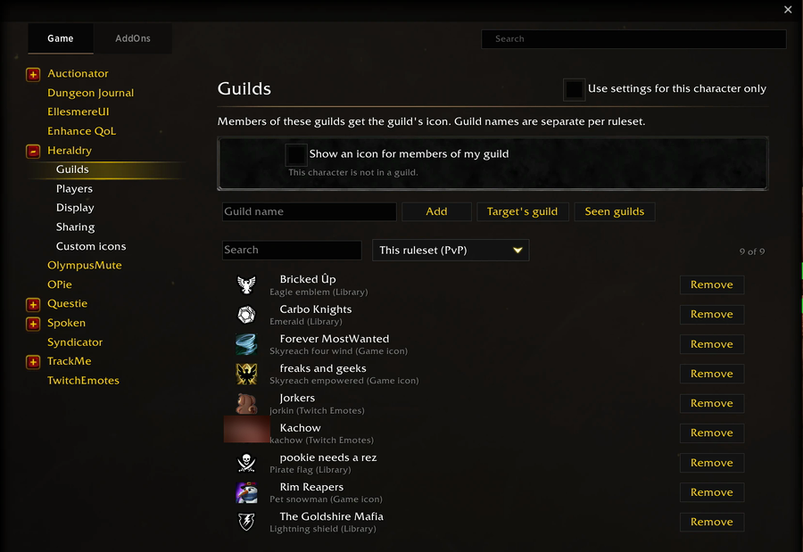</td>
  </tr>
  <tr>
    <td align="center">The Library: over 400 heraldic icons in 14 categories</td>
    <td align="center">Guilds and their icons</td>
  </tr>
  <tr>
    <td width="50%">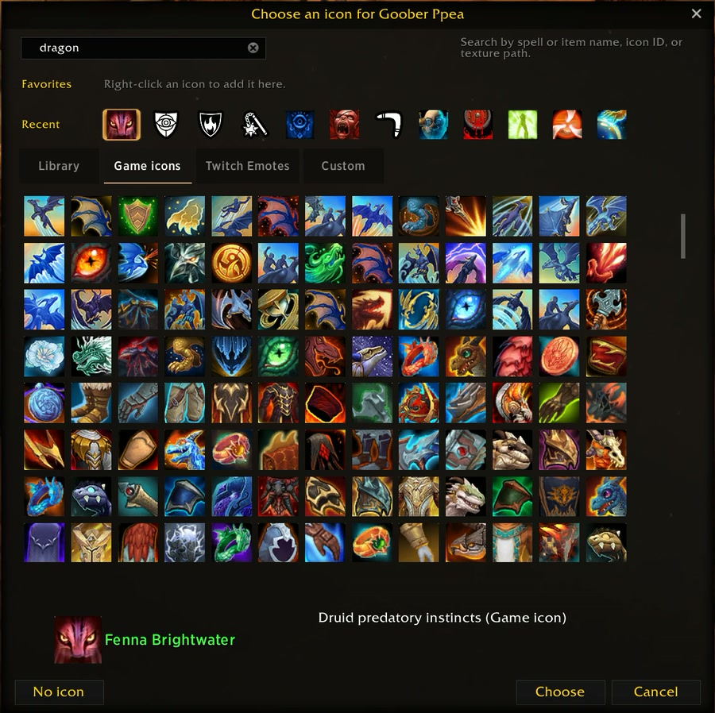</td>
    <td width="50%">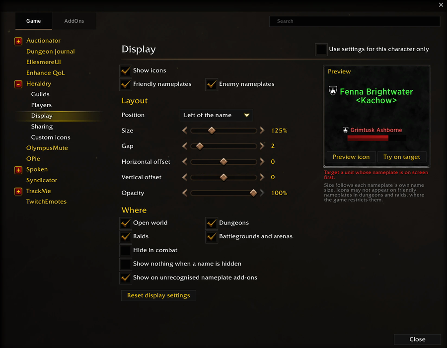</td>
  </tr>
  <tr>
    <td align="center">The icon picker: game icons named by every ability that uses them</td>
    <td align="center">Display: layout, where icons show, live preview</td>
  </tr>
  <tr>
    <td width="50%">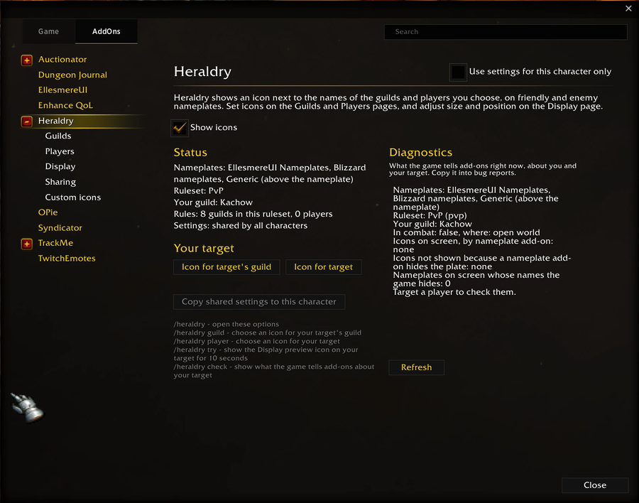</td>
    <td width="50%">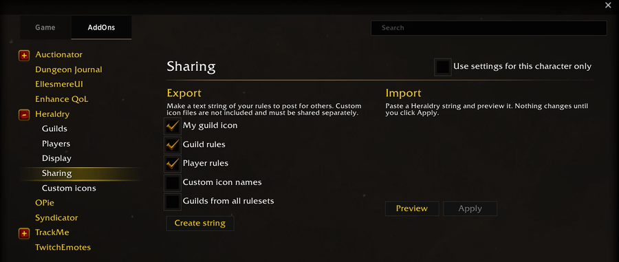</td>
  </tr>
  <tr>
    <td align="center">Status, your target and diagnostics</td>
    <td align="center">Sharing: export and import rules as text</td>
  </tr>
  <tr>
    <td width="50%">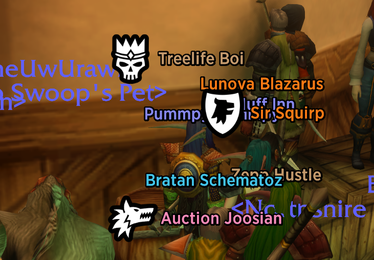</td>
    <td width="50%">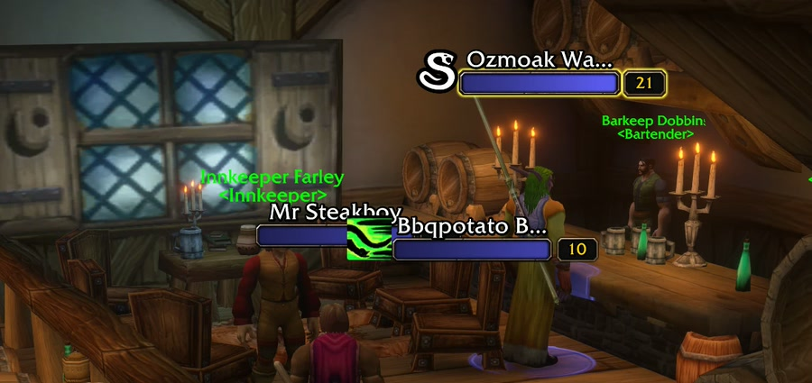</td>
  </tr>
  <tr>
    <td align="center">EllesmereUI nameplates (recommended), icons left of the name</td>
    <td align="center">Blizzard nameplates with the tall icon option</td>
  </tr>
  <tr>
    <td width="50%">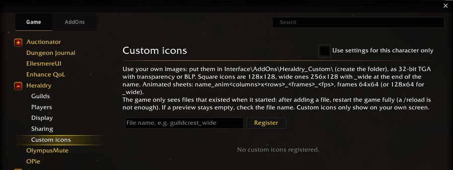</td>
    <td></td>
  </tr>
  <tr>
    <td align="center">Custom icons: your own images</td>
    <td></td>
  </tr>
</table>

## Use
- `/heraldry` opens the options (also under Game Menu > Options > AddOns, and the add-on drawer).
- The minimap button (a gold shield) is a shortcut:

  | | With a target | Without a target |
  |---|---|---|
  | Click | Choose an icon for your target | Open the Players page |
  | Right-click | Choose an icon for your target's guild | Open the Guilds page |
  | Middle-click | Remove your target's player and guild icons | Open or close the options |
  | Shift-click | Show or hide icons | Show or hide icons |
  | Shift-middle-click | Open or close the options | Open or close the options |

  `/heraldry undo` puts back what a middle-click removed. Drag the button to move it. The add-on drawer entry
  works the same way. Minimap button collectors (EllesmereUI's minimap, MinimapButtonButton) pick it up.
  `/heraldry minimap` or the checkbox on the options' first page hides it. Its tooltip says what each click
  will do right now:

  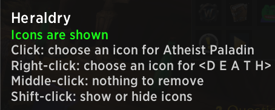
- `/heraldry guild` picks an icon for your target's guild; `/heraldry player` for your target;
  `/heraldry try` shows your preview icon on your target for 10 seconds.
- `/heraldry check` shows what the game tells add-ons about your target, for bug reports; the same report
  is under Diagnostics on the options' first page. `/heraldry outline` draws coloured boxes over your target's
  Blizzard nameplate parts (name, health bar, debuff row, raid marker) for 15 seconds.
- In the icon picker, right-click an icon to make it a favorite; arrow keys and Enter work too.

In dungeons, raids and combat the game can hide names and guilds from add-ons. Heraldry then skips what it
can't read; see the Display page and `/heraldry check`.

## Custom icons
Put 32-bit TGA (or BLP) files in `Interface\AddOns\Heraldry_Custom\`, restart the game, and register them by
name on the Custom icons page. Square icons are 128x128; add `_wide` to the name for 256x128. Animated
sheets are named `name_anim<columns>x<rows>_<frames>_<fps>` with 64x64 frames (128x64 for `_wide`).

## Credits
- Library icons and Heraldry's own icon: from [game-icons.net](https://game-icons.net) (CC BY 3.0), filled and
  outlined; each icon's author is listed in [`Heraldry/CREDITS.md`](Heraldry/CREDITS.md), generated from the
  manifest.
- Game icon names: player abilities from WoW Forever's spell tables via [wago.tools](https://wago.tools),
  and labels made from the icons' file names in the community
  [wow-listfile](https://github.com/wowdev/wow-listfile); the names themselves are Blizzard's.
- Twitch Emotes: shown from your own installed TwitchEmotes add-on and any emote pack that registers into it
  (TwitchEmotes_Giga, ...). Heraldry ships none of that art; credit belongs to those add-ons and the emotes'
  creators.

## License
Heraldry's code is under the [MIT License](LICENSE). The bundled icons keep their own license (CC BY 3.0, see
[`Heraldry/CREDITS.md`](Heraldry/CREDITS.md)).

## Development
See [`CONTRIBUTING.md`](CONTRIBUTING.md) for the layout, lint, tests, the icon tooling and releases.
